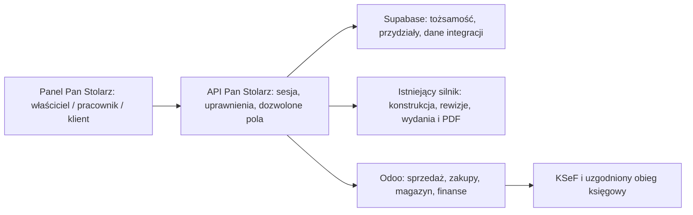

# Backend firmy Pan Stolarz — rekomendacja i plan weryfikacji

Data: 01.11.2026. Zakres potwierdzony przez właściciela: pełne zarządzanie firmą, w tym sprzedaż, faktury i rozliczenia. Zespół: właściciel, Bartek i Kacper. Dokument jest researchem i specyfikacją; nie oznacza wdrożenia ERP, uruchomienia kont ani integracji finansowej.

> **Aktualizacja zakresu — późniejsza decyzja użytkownika 01.11.2026:** faktury pozostają poza systemem, priorytetem jest praca stolarni. Aktualny plan: `PLAN-praca-stolarni.md`. Rekomendacja Odoo poniżej dotyczy wcześniejszego pełnego zakresu i nie jest bieżącym wyborem do wdrożenia. Rozwijamy obecny backend Supabase i API Pan Stolarz; nie uruchamiamy integracji bankowej ani księgowej.

## Rekomendacja

Do pełnego zakresu wybrać **Odoo jako kandydata do pilotażu ERP**, zachowując własny panel Pan Stolarz, obecny silnik i Supabase do tożsamości oraz danych technicznych. Dla integracji z hostowanym Odoo uwzględnić plan Custom z API. Ostateczny zakup uzależnić od próby obiegu jednej kuchni, akceptacji księgowości i pisemnego potwierdzenia licencjonowania pracowników korzystających przez nasz frontend.

To wybór dla szerokiego zakresu biznesowego, a nie najtańszego hostingu. Supabase daje fundament aplikacji, lecz CRM, zamówienia, magazyn i rozrachunki trzeba byłoby samodzielnie zbudować. Odoo pozwala wykorzystać gotowe procesy. Własny panel wymaga jednak realnych adapterów i ekranów — zakup ERP nie udostępni automatycznie tych funkcji w naszej aplikacji.

Jeśli pilotaż wykaże zbyt duży koszt lub niedopasowanie do księgowości, wariant rezerwowy to **Supabase + własne operacje warsztatu + API używanego polskiego programu finansowego**. wFirma jest kandydatem do szerszego obiegu księgowego, Fakturownia do fakturowania/KSeF. Fakturowni nie należy traktować jako pełnej księgowości.

## Porównanie

| Rozwiązanie | Mocna strona | Koszt integracji i ograniczenia | Ocena dla nas |
|---|---|---|---|
| Odoo + nasz panel | Gotowe moduły sprzedaży, zakupów, zapasów i produkcji; oficjalna polska lokalizacja z KSeF | API w hostowanym wariancie wymaga Custom; konfiguracja, mapowanie danych, licencje i polska księgowość do weryfikacji | Pierwszy kandydat dla pełnego zakresu |
| Supabase + polski program finansowy | Zgodność z obecnym kodem, własny prosty panel dla dwóch pracowników | Operacje firmy i magazyn wymagają budowy; synchronizacja faktur i płatności nadal potrzebna | Najlepsza alternatywa przy ograniczonym budżecie lub pozostaniu przy obecnej księgowości |
| ERPNext / Frappe Cloud | Gotowy ERP open source; hosting rozliczany zasobami, bez opłaty za każdego użytkownika | Utrzymanie i integracja; nie potwierdzono kompletnego polskiego obiegu KSeF i księgowości w standardzie | Rezerwa przy dostępnym partnerze wdrożeniowym PL |
| Directus | Uprawnienia do danych i gotowy panel administracyjny | Nie dostarcza gotowych procesów ERP; kolejna warstwa obok Supabase | Brak uzasadnienia migracji teraz |
| Appwrite / Convex | Backend aplikacyjny, uprawnienia lub reaktywność | Migracja istniejącego zaplecza; nadal brak gotowego ERP | Nie rozwiązuje głównego problemu |
| PocketBase | Prosty, samodzielny backend | Własny trwały serwer i utrzymanie; autor ostrzega przed zastosowaniami krytycznymi produkcyjnie | Nie wybierać na podstawę finansów firmy |

## Co faktycznie mamy

- `src/server/app.ts` i `src/server/access.ts`: Express, Supabase Auth, kontrola roli i przydziału projektów; oddzielne techniczne odpowiedzi API. To baza integracji, a nie gotowy ERP.
- `src/store/store.ts`: wspólny dokument JSONB `stolarnia_baza/glowna`, z globalną wersją i wykrywaniem konfliktu. Nie dopisywać tu całej ewidencji zadań, czasu, magazynu i płatności dla wielu osób.
- Obecne migracje odcinają bezpośredni dostęp `anon/authenticated`, a serwer używa uprzywilejowanego dostępu. W tej ścieżce ochronę zapewniają kontrole serwera; samo włączenie RLS nie oznacza filtrowania danych pracownika, ponieważ service role omija RLS.
- Istnieją role, przypisania, techniczne widoki i dokumenty produkcyjne. Brakuje pełnego zaplecza zadań, czasu, zakupów, ruchów magazynowych i rozrachunków. Bartek i Kacper nie mają na tej podstawie automatycznie utworzonych kont.
- Logowanie wymaga dopracowania odświeżania sesji. Nie zakładać gotowości na cały dzień pracy na podstawie samego ekranu logowania.

## Panel Bartka i Kacpra

Obaj mają osobne konta oraz te same domyślne uprawnienia. Widzą przypisane projekty i zadania; nie widzą wycen ani finansów.

1. **Dzisiaj:** własne zadania, termin, etap, blokady i szybkie wznowienie ostatniej pracy.
2. **Zadanie:** rozpocznij / wstrzymaj / zakończ, checklista, zdjęcie, opis problemu i zgłoszenie brakującego materiału. Rejestr własnego czasu bez stawek i kosztu robocizny.
3. **Projekt:** zatwierdzona dokumentacja techniczna, materiały i okucia ilościowo, wydruk kart technicznych i montażowych. Wyraźny numer wydania; zmiana projektu nie podmienia w tle wydanych kart.
4. **Narzędzia:** kalkulator szuflad, podgląd konstrukcji i pomiary. Przeliczenie robocze nie zatwierdza samodzielnie nowej wersji produkcyjnej.
5. **Montaż:** checklista, potrzebne dane miejsca montażu, zdjęcia i zgłoszenie usterki. Dostęp do danych klienta ograniczony do potrzeb zadania.

Nie przekazujemy do przeglądarki pracownika cen, marż, faktur, rozrachunków, salda klienta, stawek wynagrodzenia ani finansowych załączników. Ukrycie zakładki lub pola CSS nie jest zabezpieczeniem.

## Panel właściciela i obieg firmy

Zapytanie → pomiar → oferta → zaakceptowany zakres/umowa → zatwierdzone wydanie techniczne → zaopatrzenie → produkcja → montaż → odbiór → rozliczenie.

Właściciel widzi CRM, kalendarz, obciążenie Bartka i Kacpra, postęp, zakupy i magazyn, koszty projektu, sprzedaż, faktury oraz należności i zobowiązania. Faktury zaliczkowe, końcowe i korekty są osobnymi dokumentami. Wpłata, przyjęcie faktury przez KSeF i odbiór mebli są osobnymi zdarzeniami. Zakończenie zadania pracownika nie zatwierdza odbioru ani płatności.

Pełny zakres biznesowy nie oznacza budowania od razu własnych podatków i list płac. Sposób prowadzenia ksiąg, płac i rozliczeń ustawowych musi pasować do obsługującej firmę księgowości. Własny panel może pokazywać uzgodnione dane i statusy po API; zakres dostępny przez API trzeba sprawdzić dla konkretnych modułów.

## Architektura integracji

- Zachować TypeScriptowy silnik. Nie budować drugiej wersji konstrukcji mebla w ERP. Przekazywać do zaopatrzenia zatwierdzony wykaz materiałów z identyfikatorem wydania, nie bieżący szkic.
- ERP jest źródłem danych handlowych, stanów magazynowych i dokumentów finansowych. Supabase przechowuje mapowanie identyfikatorów i potrzebne projekcje, nie drugi niezależny rejestr tych samych faktur.
- Przyjąć jednego właściciela statusu każdego procesu. Zadanie warsztatowe może być lokalne albo ERP, ale nie może mieć dwóch niezależnie edytowanych wersji.
- Nowe lokalne tabele: przydziały, zadania i zdarzenia, czas, zgłoszenia, mapowania ERP, outbox synchronizacji i audyt. Osobne rekordy, transakcje i kontrola wersji; dane geometrii mogą pozostać JSONB w rewizjach projektu.
- Wszystkie wywołania ERP przez backend. Ograniczone uprawnienia konta integracji, jawne listy zwracanych pól i kontrola przypisania projektu. Nowe lokalne tabele objąć RLS z kontekstem użytkownika tam, gdzie to możliwe, obok kontroli serwera.
- Synchronizacja: stały klucz operacji, identyfikator zewnętrzny, retry, kolejka błędów i uzgadnianie po timeout. Nieznany wynik wysyłki faktury wymaga sprawdzenia statusu przed ponowieniem.
- Nie osadzać całego ERP w iframe. Własne widoki pobierają tylko potrzebne dane. Zaplecze ERP działa jako oddzielna usługa; nie jako trwały serwer wewnątrz funkcji Vercel.
- Rejestr audytu obejmuje przypisania, wydania, zmiany stanów i operacje finansowe. Oddzielić treści notatek warsztatowych od notatek właściciela o cenie.

## Koszty i warunki wyboru

Supabase Pro zaczyna się od **25 USD/mies.**, z pierwszym projektem w ramach podstawowego wariantu i limitami zużycia; nie jest to koszt całej aplikacji ani abonament ERP. Dochodzą hosting aplikacji, e-mail, zasoby, backup plików i ewentualne dodatki. Backup bazy nie zastępuje kopii plików dokumentacji.

Odoo wymaga wyceny Custom dla naszego sposobu integracji. Budżetować trzech użytkowników wewnętrznych jako założenie do oferty, a nie potwierdzony warunek licencji. Nie zakładać, że jeden użytkownik API pozwoli bez dodatkowych opłat obsłużyć wszystkich pracowników przez własny frontend. Potwierdzić też konto integracyjne, okres rozliczeń, VAT, rabaty, wsparcie i koszt Odoo.sh, jeśli potrzebne będą własne moduły. Nie podaję niezweryfikowanej ceny za stanowisko.

ERPNext: brak opłaty za użytkownika nie oznacza bezkosztowego wdrożenia. Hosting, zasoby, kopie, aktualizacje, lokalizacja i wsparcie wymagają budżetu. W każdym wariancie osobno oszacować budowę własnych ekranów i adapterów oraz ich utrzymanie.

## Etapy i kryteria odbioru

| Etap | Zakres | Dowód gotowości |
|---|---|---|
| P0 — pilot wyboru | Jedna przykładowa kuchnia, bez danych produkcyjnych: klient, oferta, materiały, zakup, produkcja, montaż, zaliczka i rozliczenie | Pokrycie wymaganych operacji przez API; oferta licencji; księgowość akceptuje obieg i eksport/import |
| P1 — codzienna praca | Osobne konta Bartka i Kacpra, odświeżanie sesji, przydziały, zadania, czas, zgłoszenia i zatwierdzone dokumenty | Równoczesna praca bez utraty zmian; pracownik nie odczyta cudzego projektu ani żadnych kwot przez API, PDF, załączniki, wyszukiwanie i powiadomienia |
| P2 — firma | CRM, zamówienia, zapasy i rezerwacje, zakupy, kontrolowany przepływ wydania technicznego do ERP | Zmiana ilości tworzy audytowany ruch; zakup/faktura nie udaje przyjęcia dostawy; ponowienie synchronizacji nie duplikuje zamówienia |
| P3 — finanse | Faktury, KSeF, płatności częściowe, należności, zobowiązania i koszty projektów | Testy zaliczki, końcowej, korekty, odrzucenia i timeout w środowisku testowym; numer KSeF po potwierdzonym przyjęciu; uzgodnienie sald z księgowością |

Całość obejmuje pełny zakres wskazany przez użytkownika; kolejność ogranicza ryzyko uruchomienia finansów przed sprawdzeniem danych. Przed migracją: kopia, próba odtworzenia, mapowanie identyfikatorów, porównanie liczby rekordów i kwot, zachowanie uzgodnionych cen i wydanych dokumentów. Konto pracownika odebrane przez właściciela musi utracić dostęp również do plików.

Do uruchomienia pilotażu potrzebna jest informacja o obecnym programie księgowym i sposobie współpracy z księgowością. Do zaproszenia pracowników potrzebne będą ich adresy e-mail. Te braki nie blokują wyboru architektury, lecz nie pozwalają jeszcze potwierdzić kompletnej integracji produkcyjnej.

## Źródła i ograniczenia researchu

Oficjalne źródła wyszukane 01.11.2026. Bezpośredni odczyt części stron Odoo przekroczył czas; informacje o Custom i polskiej lokalizacji potwierdzają wyniki indeksowanych oficjalnych stron. Nie potwierdzono ceny licencji ani działania integracji na koncie Pan Stolarz. Nie znaleziono w wykorzystanych oficjalnych materiałach dowodu kompletnej polskiej lokalizacji ERPNext; to luka do weryfikacji, nie dowód jej braku.

- Odoo — [plany i API](https://www.odoo.com/pricing), [dokumentacja API](https://www.odoo.com/documentation/19.0/developer/reference/external_api.html), [produkcja](https://www.odoo.com/app/manufacturing).
- Odoo — [polska lokalizacja, w tym moduł l10n_pl_edi FA(3)](https://www.odoo.com/documentation/19.0/pl/applications/finance/fiscal_localizations/poland.html). Obecność modułu nie zastępuje próby naszego obiegu i akceptacji księgowości.
- ERPNext — [licencja i hosting](https://frappe.io/erpnext/pricing), [projekty](https://docs.frappe.io/erpnext/project), [uprawnienia](https://docs.frappe.io/erpnext/role-based-permissions).
- Supabase — [cennik](https://supabase.com/pricing).
- wFirma — [API i uwagi do uprawnień integracji KSeF](https://pomoc.wfirma.pl/-api-interfejs-dla-programistow).
- Fakturownia — [API](https://fakturownia.pl/api), [KSeF](https://fakturownia.pl/apps/ksef), [FAQ integracji](https://pomoc.fakturownia.pl/faq-integracja-z-ksef-w-fakturowni-odpowiedzi-na-najczestsze-pytania-klientow). Starsze przykłady API mogą dotyczyć DEMO; endpointy i środowisko sprawdzić przed wdrożeniem.
- Inne backendy — [Directus access control](https://directus.com/docs/guides/auth/access-control), [Appwrite TablesDB](https://appwrite.io/docs/products/databases/tablesdb/permissions), [Convex](https://docs.convex.dev/realtime), [PocketBase — ostrzeżenie produkcyjne](https://pocketbase.io/docs/).
- MF — [wsparcie integratorów KSeF](https://ksef.podatki.gov.pl/ksef-na-okres-obligatoryjny/wsparcie-dla-integratorow/).

Powiązane ustalenia: `RESEARCH-silnik-mebli-i-konta.md` oraz `RESEARCH-KSeF-i-obieg-finansowy-2026-10-05.md`. Niniejszy dokument rozszerza zakres o pełny ERP; nie zmienia algorytmów silnika ani historycznych dokumentów.
